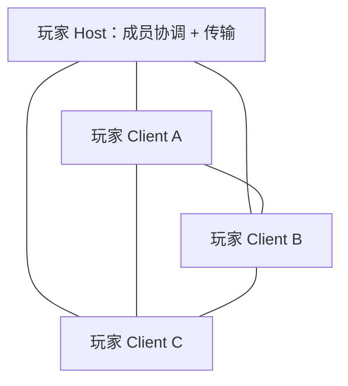

# touchHLE 独立 LAN P2P 传输层

日期：2026-10-27。基线：`47e9bf7c`，叠加尚未提交的网络诊断改动。本阶段阅读了 [NETWORK_ANALYSIS.md](NETWORK_ANALYSIS.md) 和 [NETWORK_TRACE.md](NETWORK_TRACE.md)，只新增独立传输能力；不接入 GameKit、不修改 MHP2G，不添加房间发现、启动器配置、专用服务器或公网服务。

## 1. 拓扑与边界

最多四人，包含 Host 自身。每个实例运行相同的 `Transport`，拥有自己的监听端口和后台 worker。Host 的 worker 同时承担成员协调；不需要第五个进程或专用服务器程序。



Host 对加入请求校验版本、兼容 tag、人数和 ID，并通过已有 Host–Client 连接分发成员名单。两个 Client 按 ID 大小确定唯一发起方，建立各自的直接 TCP 连接。数据只在目标玩家的直接连接上传送；Host 不转发其他玩家的数据。

这是一份 UF 自定义传输协议，不是恢复出的 Apple GameKit 协议。`Joined` 仅表示加入传输会话，`PeerConnected` 仅表示某条直连已完成握手；都不代表游戏已经匹配成功，也不保证四人所有链路已经就绪。后续适配层需要等待所需玩家的直连事件。

## 2. 模块和接口

| 文件 | 关键入口 |
| --- | --- |
| [src/transport/mod.rs](src/transport/mod.rs) | 公共 `Transport`、`Config`、`Role`、`Event`、`Failure`、`PlayerId`、`SessionId` |
| [src/transport/wire.rs](src/transport/wire.rs) | `encode`、`Decoder::next`、`roster` / `parse_roster`；显式字节编码和验证 |
| [src/transport/worker.rs](src/transport/worker.rs) | `run`、`Worker::tick`、`frame`、`accept_join`、`peer_hello`、`cleanup`；私有 socket 状态机 |
| [examples/transport_peer.rs](examples/transport_peer.rs) | 独立进程测试探针，JSON 行控制，不是产品的服务程序 |
| [dev-scripts/transport-integration-tests.py](dev-scripts/transport-integration-tests.py) | 启动多个独立探针进程，执行断言并保存事件日志 |

模块只使用 Rust 标准库和项目已有的 `uuid` 依赖。没有新增 Cargo 依赖；探针沿用已有 `serde_json`。生产改动仅在 `lib.rs` 导出模块，不创建全局实例、不修改 Framework 或模拟器主循环。

```rust,ignore
use touchHLE::transport::{Config, Delivery, PlayerId, Role, Transport};

let local_id = PlayerId::random(); // 调用者保存并在重连时复用
let config = Config::new(local_id, "0.0.0.0:0".parse()?, [7; 16]);
let mut transport = Transport::start(config, Role::Host)?;
// Client 改用 Role::Client("192.168.1.10:12345".parse()?)。
// 从 Event::Listening 得到实际端口，从 PeerConnected 得到目标 ID。
transport.try_send(remote_id, vec![0, 255, 0], Delivery::ReliableOrdered)?;
while let Some(event) = transport.poll() {
    // 此处由调用者消费字节和事件；worker 不调用模拟器。
}
transport.disconnect(); // 请求退出，不等待 join 或网络发送完成
```

该示例为接口说明，`remote_id`、错误类型和事件处理需由调用者提供。模块没有文件持久化或 UI；`PlayerId::random()` 生成 UUID v4 的 16 字节值，调用者可传入已有非零 ID。它是会话身份标识，不是设备认证，也不规定未来 guest playerID 的字符串格式。

Host 每次启动生成新的 `SessionId`。同一会话同时存在的重复玩家 ID 被拒绝；玩家离开并从名单移除后，可用原 ID 建立新连接。跨连接不保留未确认消息、顺序号或游戏状态。

未来接入模拟器时，调用者必须先检查现有 `options.network_access`；本阶段没有接入该路径，也没有改变现有联网开关。显式调用 `Transport::start` 的测试探针可以独立运行，无需 Environment、IPA 或游戏存档。

## 3. 不阻塞主线程与所有权

`Transport::start` 在调用线程只验证配置、创建队列并启动一个 worker。监听、连接、accept、读写、握手、超时和名单管理都在该 worker 中进行。所有 socket 都由它独占；没有每连接线程，也没有全局锁或跨实例单例。

- `try_send` 使用有界 `SyncSender::try_send`；返回 `QueueFull` 时没有入队。入队成功仅表示命令已接受，不是远端已收到。
- 若目标尚未连通或 worker 输出队列已满，接受后的发送通过 `Event::Error` 报告 `PeerUnavailable` / `Backpressure`，不把载荷悄悄丢弃后声称送达。
- `poll` 每次使用 `try_recv`，最多取一个事件，不等待网络。
- `disconnect` / Drop 仅设置原子停止标志，不 join worker。正常 leave 也不承诺排空未发送消息；远端通过 EOF / socket 错误观察断开。
- 标准库队列和线程创建不是硬实时保证；没有在模拟器调用线程等待 socket 或工作线程退出。

worker 通过 `TcpStream::connect_timeout` 建连，默认单次 100 ms、配置最大 250 ms；该等待只发生在 worker。读写 / accept 为 nonblocking，正确处理 WouldBlock、Interrupted、短读短写和 EOF。循环以 5 ms 为基础间隔，每连接每轮各限制 32 KiB I/O、最多解析 32 帧；一次最多尝试三条客户端直连，故连接失败时 worker 自身也可能延后处理其他链路。这是标准库轮询 MVP 的时序限制，不能用作游戏延迟已达标的证据。

事件和命令只包含普通 Rust ID、地址、枚举和拥有所有权的 `Vec<u8>`，没有 `id`、`Ptr`、`GuestFunction`、Environment 引用或运行时回调。后续适配层必须在模拟线程取出事件后复制成客体对象，不能把 worker 改成直接调用 ObjC。

## 4. TCP 与后续低延迟接口

本阶段只实现 `Delivery::ReliableOrdered`：每对玩家一条 TCP 连接，设置 TCP_NODELAY；在连接有效且未报告发送错误时，以 TCP 字节顺序还原独立消息。顺序保证限定于同一方向、同一连接；不同发送者之间没有全局顺序。

不实现应用层送达确认或断线续传。TCP 写入成功不能证明游戏已经处理数据，进程异常 / EOF / leave 前的在途消息不能承诺交付。应用若需要“已处理”语义，应在未来协议上另行定义确认，不能盲目重放可能已交付的载荷。

`Delivery::Unreliable` 预留给未来 UDP 通道，当前同步返回 `UnsupportedDelivery`；不会悄悄走 TCP。TCP 存在丢包时的队头阻塞，不能将本阶段视作 MHP2G 非可靠通道的性能验证。后续 UDP 应明确 datagram 大小、会话校验、乱序 / 丢弃语义和 MTU，再扩展协议版本或能力协商。

## 5. 版本化帧协议 v1

所有整数均为大端，所有 ID 固定 16 字节；禁止直接传输 Rust 结构体的内存布局。每个 TCP 方向从序号 0 开始，所有帧（包括控制帧）统一递增。序号不符、溢出、坏 magic、未知版本 / 类型、非零保留位或非法状态转换均断开该连接。

| 偏移 | 长度 | 字段 |
| --- | --- | --- |
| 0 | 4 | ASCII `UFTP` |
| 4 | 2 | 协议版本，当前必须为 1 |
| 6 | 1 | 帧种类，见下表 |
| 7 | 1 | 保留 flags，当前必须为 0 |
| 8 | 4 | payload 字节长度，最大 65536 |
| 12 | 8 | 此连接方向的序号 |
| 20 | length | payload，长度可以为 0 |

| kind | 名称 | payload |
| --- | --- | --- |
| 1 | Join | 玩家 ID(16) + 监听端口(2) + compatibility tag(16)，共 34 字节 |
| 2 | Welcome | Session ID(16) + Host ID(16) + Roster |
| 3 | Roster | count(1) + count 个成员条目；count 为 1–4 |
| 4 | PeerHello | 玩家 ID(16) + Session ID(16) + compatibility tag(16)，共 48 字节 |
| 5 | Data | 不透明应用字节，0–65536 字节；来源由该直连绑定的 ID 确定 |
| 6 / 7 | Ping / Pong | 空载荷 |
| 8 | Reject | 原因码(1)：1 房间满，2 ID 重复，3 compatibility 不匹配 |

成员条目为玩家 ID(16) + IPv4 地址(4) + 监听端口(2)，共 22 字节。成员数、长度、非零端口 / ID 和 ID 唯一性都验证；客户端还要求名单包含 Host 和自身。Host 以 TCP 对端源 IP 加 Join 的监听端口构造成员地址；不接受客户端自行宣称另一 IP。

监听 `0.0.0.0` 时 Host 的本地名单地址可能是 wildcard；客户端将 Host 条目替换为其实际连接的 Host 地址。客户端之间使用 Host 观察到的各自 IP，必须直接可路由且允许连接监听端口。本阶段不支持 IPv6、NAT 打洞、地址重写、端口映射或多接口地址协商。未来 VPN 必须能路由这些公布地址，不能因此承诺任意 VPN 环境可用。

Decoder 在拿到完整头部后立即校验长度，不按攻击者宣称的长度无限分配；不完整帧保留等待下一次读取，多帧可以一次到达。EOF 若留有残帧按 `truncated frame` 处理。已经从连接取得的正常帧在事件中保持二进制边界，不依赖字符串、换行或 NUL 分隔。

## 6. 连接与会话状态

```text
Host start → Listening → Joined(自身的新 Session) → 接受 Join
    Join 合法 → Ready(peer) → Welcome(名单) → 向其他 Client 推送新名单
    Join 不合法 → Reject 或 Protocol error → 关闭

Client start → Listening → connect Host → 发送 Join → 等待 Welcome
    Welcome 合法 → Joined → PeerConnected(Host) → 安装成员名单
    对其他 Client：较大 ID 发起 TCP → 双方 PeerHello 校验 → Ready(peer)

Ready → Data / Ping / Pong / 来自 Host 的 Roster
    EOF / I/O 错误 / 超时 / 协议错误 → PeerDisconnected
    Host 丢失 → 客户端整个 Transport 停止（HostLost）
```

成员公告与直连建立可能交错。对尚未收到名单的一方，过早到达的 PeerHello 按现有名单拒绝；唯一发起方退避重试，直至合法连接建立或 Host 移除成员。客户端直连中断后也按同一规则重试：握手失败退避 200 ms、connect 失败退避 500 ms。错误通过事件上报。没有连接到 Host 的自动重新加入；调用者需显式创建新的 Transport。

Host 检测到成员断线后先移除成员，再公告名单。其他 Client 关闭已离开成员的连接。最多同时接纳 Host + 3 Client；额外保留最多 8 个 socket（包括尚未认证的握手）以处理加入 / 拒绝，但这不增加成员容量。

Host 离开时所有客户端终止本次传输会话；不实现 Host 迁移、后台恢复、游戏状态恢复或旧消息重播。异常恢复的本阶段含义为：存活 Host 清理旧成员，允许相同 ID 的新进程重新加入，并重建直连。

## 7. 资源、超时与错误

| 项目 | 默认值 / 策略 |
| --- | --- |
| 玩家数 | 最多 4，包含 Host |
| 活跃 / 待握手 socket 总数 | 每 worker 最多 8 |
| 应用消息 | 最多 65536 字节，允许空消息 |
| 命令 / 事件队列 | 各 64 项，可配置 1–1024；每项载荷最多 64 KiB |
| 每连接写队列 | 最多 1 MiB 未发送字节，且最多 256 帧 |
| 每连接读缓存 | 不超过 20 + 65536 字节；每轮另有固定 I/O 和帧预算 |
| 初次 / 直连握手超时 | 3 秒，按建连后时间计算，碎片输入不刷新握手期限 |
| 心跳 | 每秒 Ping；5 秒未收到完整有效帧后判超时 |
| worker 调度 | 基础轮询间隔 5 ms；connect 等待也仅在 worker |
| 事件消费者跟不上 | 不静默丢 Data；终止该 Transport，关闭连接，最终报告 EventBackpressure |

事件队列满时无法把错误再塞入同一个队列，因此通过独立原子退出状态保存终止原因。调用者排完已缓存事件后，`poll` 会合成唯一的 `Stopped(EventBackpressure)`；此后返回 None。worker 意外退出也会结束通道并报告 WorkerFailed。没有因满队列阻塞模拟器或无限积压。

`Failure` 区分 I/O ErrorKind、协议错误、超时、EOF、人数满、重复 ID、兼容 tag 不符、目标未连接和写背压；`SendError` 区分命令队列满、已停止、过大消息、不支持的投递模式。错误与断开不是成功回调。绑定失败和拒绝连接都通过异步事件反馈，`start` 成功只代表 worker 已启动。

## 8. 信任与未实现项

本阶段面向受信任、可直连的局域网。UUID、Session ID 和 compatibility tag 提供身份区分与误连接筛选，不提供密码学认证或加密；能访问监听端口的同网攻击者可能冒用 ID 或耗尽待握手名额。长度、队列、数量和握手期限有上限，但不是完整抗 DoS 设计。

兼容 tag 由调用者提供；测试使用 `UF-TRANSPORT-V1!`。未来接 GameKit / 游戏时，必须根据真实运行证据定义 Bundle ID、版本、group / attributes 等兼容维度，不能把这个演示 tag 当成已完成游戏匹配筛选。

当前没有自动发现、UDP、外部服务器、Relay、TLS、应用层送达确认、会话恢复、后台运行保证、GameKit 对象 / delegate 或 MHP2G 控制包。Host 退出结束会话是明确边界，不会偷偷换房主。

## 9. 编译和独立实例测试

```sh
CMAKE_POLICY_VERSION_MINIMUM=3.5 cargo build --release
CMAKE_POLICY_VERSION_MINIMUM=3.5 cargo build --release --example transport_peer
CMAKE_POLICY_VERSION_MINIMUM=3.5 cargo test --release --lib
python3 dev-scripts/transport-integration-tests.py
```

测试仅监听 `127.0.0.1` 的临时端口；沙箱限制 bind 时需允许本机回环网络。测试同时运行多个真实 OS 进程，既不是同进程两个对象，也不是两个连接指向外部服务器。它不运行 IPA，不使用 GameKit mock。

手动两终端运行（使用同一 compatibility tag 的探针）：

```sh
# 终端 A，实际 Host 是玩家自身
target/release/examples/transport_peer host 127.0.0.1:41000 - 00000000000000000000000000000001
# 终端 B
target/release/examples/transport_peer client 127.0.0.1:0 127.0.0.1:41000 00000000000000000000000000000002
```

看到 connected 后，在 B 输入：

```json
{"command":"send","to":"00000000000000000000000000000001","bytes":[0,255,0,128]}
```

A 应收到 `data` JSON 事件；A 可用同样命令向 ID 02 回送。`{"command":"leave"}` 请求离开。进程打印的 `command_result` 只表示 API 接受 / 拒绝，不表示数据送达。`--fast` 只供自动测试缩短握手 / 心跳期限，不改变帧协议。

完整执行结果与边界见 [TRANSPORT_TEST_REPORT.md](TRANSPORT_TEST_REPORT.md)。完成本阶段后停止；后续可依据在线入口真实调用轨迹设计适配层，但不会在这里开始房间发现或 GameKit 模拟。
